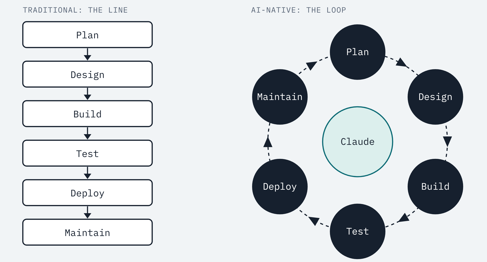
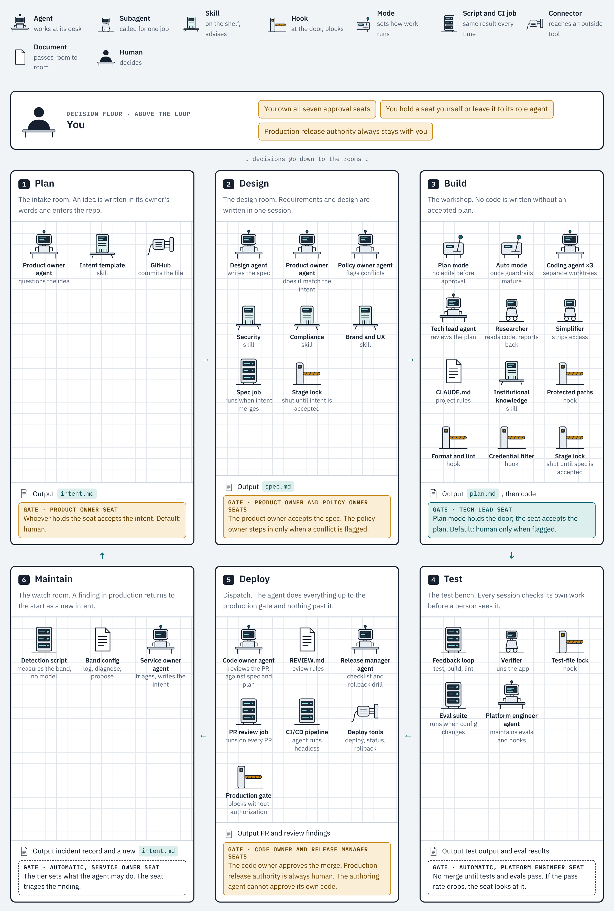
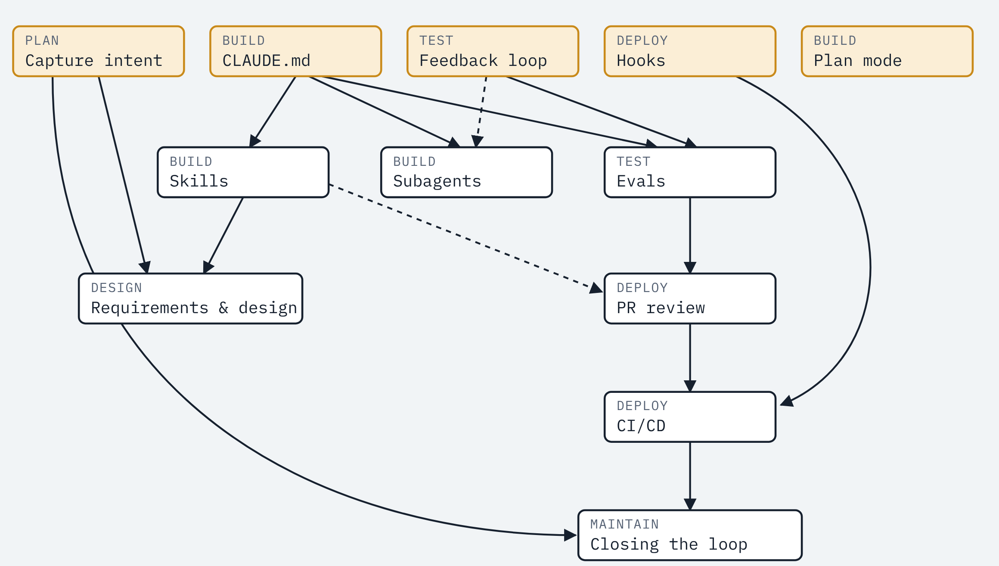

# ai-native-sdlc

A Claude Code plugin that runs a software lifecycle as six rooms in one office. Each room is a stage. Agents sit at desks, skills stand on shelves, hooks wait at the doors. Each room ends with a document, and the next door does not open until that document is accepted. The human sits above the loop and decides.

Based on [The AI-native SDLC playbook](https://claude.com/resources/articles/the-ai-native-sdlc-playbook) by Louis Claxton, Anthropic. This project is an independent implementation and is not published or endorsed by Anthropic. Running the seven roles as agents is this project's interpretation: the playbook assigns those roles to people, and mentions a reviewing agent only as a confidence gate in the headless loop.



From the line to the loop: this project's drawing of the playbook's second figure. In the traditional process a loop back is a new release cycle. In the AI-native process the stages form a ring, AI works at each one, and people stay above the loop to start, direct and govern it.

## Contents

- [The source it follows](#the-source-it-follows)
- [Install and set up](#install-and-set-up)
- [A first change, start to finish](#a-first-change-start-to-finish)
- [Office roster](#office-roster)
- [Order rule](#order-rule-one-finishes-before-the-next-starts)
- [Approval seats](#approval-seats)
- [Room files](#room-files)
- [Who decides the language and stack](#who-decides-the-language-and-stack)
- [File tree](#file-tree)
- [Setup order](#setup-order)
- [What has been tested, and what has not](#what-has-been-tested-and-what-has-not)
- [Reference](#reference)

## The source it follows

This plugin does not invent a method; it installs a published one. The playbook collects the practices Anthropic's Applied AI team uses with customers. It is not a formal standard; it is Anthropic's own published guide to running the software lifecycle with Claude Code.

| | |
|---|---|
| **A known source** | The six stages, the artifact chain and the gates come from the playbook. The table below shows which play each part rests on. |
| **Ready to use** | The playbook describes the method and shows short samples. It does not ship an installable package. This plugin provides one. |
| **Fitted to one person** | The playbook is written for large organizations. Approval seats let the same setup run in a one-person company. |

### Where each play lives in this plugin

| Stage | Play in the playbook | Its counterpart here |
|---|---|---|
| Plan | Capture as intent.md | `/ai-native-sdlc:intent`, the intent template, the `product-owner` agent |
| Design | Requirements and design | `/ai-native-sdlc:spec`, the `designer` agent, the policy skills, the spec workflow |
| Build | Claude Code plan mode as the default starting point | `/ai-native-sdlc:plan`, the `tech-lead` agent, the stage lock |
| Build | Claude Code on auto mode | Not configured by the plugin; turn it on once the guardrails have matured |
| Build | The CLAUDE.md | A starter `CLAUDE.md` template |
| Build | Skills as institutional knowledge | Three starter policy skills, one rule set each |
| Build | Hooks as build-time guardrails | Protected paths, format and lint, credential filter |
| Build | Parallel sessions and subagents | `researcher`, `simplifier`, `verifier`; worktrees are yours to start |
| Test | Give Claude a feedback loop | The verification block in `CLAUDE.md`, the `verifier`, the test lock |
| Test | Continuous evals in CI | `evals/` and the `agent-evals` workflow |
| Deploy | AI in the PR review loop | The `code-owner` agent, `REVIEW.md`, `/ai-native-sdlc:pr-babysit`, the `pr-review` workflow |
| Deploy | Hooks as approval gates | The production gate and the acceptance gate; approval seats |
| Deploy | CI/CD integration and deployment | The `release` workflow with a protected production environment |
| Maintain | Maintenance and closing the loop | `ops/detect.py`, `ops/bands.json`, the `service-owner` agent, the `monitor` workflow |
| Maintain | Claude on call with Claude Tag | Out of scope; needs an enterprise Slack setup |

## Install and set up

```bash
claude plugin marketplace add /path/to/ai-native-sdlc
```

```bash
claude plugin install ai-native-sdlc@ai-native-sdlc-local
```

Then, in the project repository, run `/ai-native-sdlc:init`. It copies the templates and never overwrites an existing file. Three things only you can do afterwards:

1. Turn on branch protection for the default branch: require a pull request, the `stage-check` status and code owner review.
2. Add `ANTHROPIC_API_KEY` to the repository secrets if you enable the CI jobs that call Claude.
3. Put your name in `sdlc/seats.json` and your handle in `CODEOWNERS`.

Requirements: Claude Code with plugin support, Python 3.9 or later, git.

## A first change, start to finish

1. `/ai-native-sdlc:intent` and describe the problem. Merge the intent pull request.
2. `/ai-native-sdlc:spec <name>`. On a new project the spec includes a Technology choice section. Merge the spec pull request.
3. `/ai-native-sdlc:plan <name>` on a `change/<name>` branch. When the plan is accepted, the stage lock opens for code.
4. Implement, run the checks, open the pull request, `/ai-native-sdlc:pr-babysit`.
5. Approve and merge. Authorize the release.

Small, well-bounded fixes use a `fix/<name>` branch: they need an accepted plan but no intent or spec, and committed tests cannot be edited.

## Office roster



The drawing is the design this plugin implements. A browsable version with every room's file is in [`docs/agent-office.html`](docs/agent-office.html).

| Type | Count | Which |
|---|---|---|
| Role agent | 7 | `product-owner`, `policy-owner`, `tech-lead`, `platform-engineer`, `code-owner`, `release-manager`, `service-owner` |
| Working agent | 2 | `designer`, and the coding agent, which is your main Claude Code session |
| Subagent | 3 | `researcher`, `simplifier`, `verifier` |
| Skill, in the plugin | 5 | `init`, `intent`, `spec`, `plan`, `pr-babysit` |
| Skill, copied into the project | 3 | `security`, `compliance`, `brand-ux`; starter rules you replace with your own |
| Gate held by a hook | 6 | Stage lock, protected paths, test lock, credential filter, production gate, acceptance gate; plus format and lint after each edit |
| Script and CI job | 7 | Stage check, spec job, feedback loop, eval suite, PR review job, release pipeline, detection script |
| Document | 7 | `intent.md`, `spec.md`, `plan.md`, `CLAUDE.md`, `REVIEW.md`, `ops/bands.json`, `sdlc/seats.json` |
| Approval seat | 7 | One per role; who sits in it comes from config |

Role agents can read and search but cannot write files. They review; they do not produce the work they review.

## Order rule: one finishes before the next starts

Three layers hold the rule. If one is skipped, another catches it.

| Layer | Where it runs | What it does |
|---|---|---|
| Stage lock (hook) | Inside the agent, before every file write | Looks at which room the file belongs to. If the previous room's document is not accepted, it blocks the write and says why |
| Stage check (CI) | On every pull request | A pull request that brings `spec.md` needs an accepted `intent.md`; one that brings code needs an accepted `spec.md` and an accepted `plan.md`. Otherwise the merge is stopped |
| Branch protection | On GitHub | Only approved pull requests reach the default branch |

"Accepted" has one meaning for an intent or a spec: the file is on the default branch. A plan is accepted through a record in `sdlc/acceptance/` that pins the plan's content; editing the plan afterwards voids the record.

| Transition | What opens it | Where it returns if it stays shut |
|---|---|---|
| Plan → Design | `intent.md` merges to the default branch | Back to the originator with questions |
| Design → Build | `spec.md` merges to the default branch | To the designer; to Plan if the intent is incomplete |
| Inside Build | `plan.md` is accepted | The plan is revised; to Design if the spec is incomplete |
| Build → Test | The coding agent reports done | Stays with the coding agent until tests pass |
| Test → Deploy | Tests and evals pass, a pull request opens | To the coding agent |
| Deploy → production | The code owner merges, the release manager authorizes | To Build; to Design if the spec was wrong |
| Maintain → Plan | A band is breached or a new item arrives | Every new item enters the chain at Plan |

## Approval seats

Each of the seven roles has an approval seat. Who sits in it comes from `sdlc/seats.json`. One person can hold all seven; as the team grows, seats are handed over and the setup stays the same.

| Seat | What it approves | Default setting |
|---|---|---|
| Product owner | Acceptance of the intent and the spec | `human` |
| Policy owner | Security and compliance conflicts flagged in the spec or the pull request | `human-when-flagged` |
| Tech lead | The plan; the technology choice; the spec for higher-risk work | `human-when-flagged` |
| Platform engineer | Changes to the rules file, skills and hooks; eval results | `human-when-flagged` |
| Code owner | Merging a pull request to the default branch | `human` |
| Release manager | Production release | `human`; the stage check rejects any other value |
| Service owner | A monitoring finding: fix now, schedule or dismiss | `human-when-flagged` |

| Setting | What happens |
|---|---|
| `human` | The role agent does the first pass and writes its findings; the named person approves |
| `human-when-flagged` | The role agent passes the work if it finds nothing, and escalates to the person if it does |
| `agent` | The role agent approves |

- **The author cannot approve.** The acceptance gate lets only the `tech-lead` agent record a plan's acceptance, never the session that wrote the plan.
- **Production release is always human.** The release manager seat cannot be set to `agent`.
- **A check stands behind every role agent.** An agent's approval is advisory; what enforces the rule is the hook, the CI check and branch protection.

A change is flagged when it touches a path under `risk_paths` in `sdlc/config.json`, adds or upgrades a dependency, changes a public API or a data model, or conflicts with a policy skill.

```json
{
  "product-owner":     { "person": "you", "setting": "human" },
  "policy-owner":      { "person": "you", "setting": "human-when-flagged" },
  "tech-lead":         { "person": "you", "setting": "human-when-flagged" },
  "platform-engineer": { "person": "you", "setting": "human-when-flagged" },
  "code-owner":        { "person": "you", "setting": "human" },
  "release-manager":   { "person": "you", "setting": "human" },
  "service-owner":     { "person": "you", "setting": "human-when-flagged" }
}
```

## Room files

Everything each room needs: who works there, which files are involved, how the gate is held, how the work runs and how it is measured. Paths starting with `agents/`, `skills/`, `hooks/` and `scripts/` are in this plugin. Other paths are in your project after `init`.

### 1 Plan

An idea is written once, in its owner's words, and becomes a document the next room can read.

- **Input:** a person's idea, a filed ticket, or a finding from the Maintain room
- **Output:** `intent/<name>/intent.md`
- **Prerequisite:** none; the chain can start here

| Part | Type | Job | File |
|---|---|---|---|
| Product owner agent | Role agent | Asks what an analyst would ask: scope, users, constraints, what success looks like. Checks the document against the template | `agents/product-owner.md` |
| Intent template | Template | Defines the five sections | `templates/intent/intent.md` |
| `/ai-native-sdlc:intent` | Skill | Runs the conversation and writes the document | `skills/intent/SKILL.md` |

Sections of the document: Problem · Proposed outcome · Affected users and systems · Constraints · Open questions.

**Gate: product owner seat, default `human`.** All five sections are filled and the originator has corrected any misunderstanding. Enforced by branch protection: the intent reaches the default branch only through an approved pull request. If it fails, it goes back to the originator with questions.

How the work runs:
1. The originator describes the problem in their own words.
2. The product owner agent asks questions until the idea is concrete.
3. The result is written as `intent.md` from the template.
4. The originator corrects anything that was misunderstood.
5. The intent opens as a pull request; the seat accepts or rejects it.

Measurement: time from first conversation to a committed intent (leading); share of intents accepted, and changes to the intent after the spec is written (lagging).

### 2 Design

Requirements and design are written in one session. Policy is applied while the spec is written rather than found in a review weeks later.

- **Input:** an accepted `intent.md`
- **Output:** `intent/<name>/spec.md`, next to the intent
- **Prerequisite:** the Plan room and the policy skills

| Part | Type | Job | File |
|---|---|---|---|
| Design agent | Working agent | Writes the spec from the intent; states clearly where it cannot satisfy conflicting policies | `agents/designer.md` |
| Product owner agent | Role agent | Checks that the spec solves the stated problem and that open questions are answered or carried forward | `agents/product-owner.md` |
| Policy owner agent | Role agent | Lists flagged conflicts so each can be resolved with the owner of that policy | `agents/policy-owner.md` |
| Security, compliance, brand and UX | Skill | The policies the spec has to follow | `.claude/skills/security/`, `compliance/`, `brand-ux/` |
| `/ai-native-sdlc:spec` | Skill | Runs the designer and the reviewing agents in order | `skills/spec/SKILL.md` |
| Spec job | CI job | Runs headless when an intent merges and opens the spec as a pull request | `.github/workflows/spec.yml` |
| Stage lock | Hook | Blocks writing `spec.md` before the intent is accepted | `hooks/pre_write.py` |

Sections of the document: Requirements (numbered, each with an acceptance criterion) · Design · Technology choice (first change only) · Flagged concerns · Open questions carried from the intent.

**Gate: product owner seat, default `human`.** The spec meets the intent and every flagged concern is resolved. The policy owner seat steps in only when a concern is flagged; the tech lead seat for the technology choice and for higher-risk work. Enforced by branch protection and the stage check. If it fails, it goes back to the designer, or to Plan if the intent is incomplete.

How the work runs:
1. At first the skill is run by hand; once the routine holds, the spec job starts by itself when an intent merges.
2. The designer writes the spec with the policy skills loaded.
3. Flagged concerns are worked through first; they are the points an analyst would have escalated.
4. The spec is committed next to the intent. The pair records what was asked for and what was decided.
5. The seat decides whether the spec moves on to Build.

Measurement: time between the intent commit and the spec commit (leading); changes to the spec after the plan is written (lagging).

### 3 Build

Nothing is implemented without an accepted plan. Institutional knowledge becomes files the agent reads; guardrails run as code rather than as habits.

- **Input:** an accepted `spec.md` and `intent.md`
- **Output:** `intent/<name>/plan.md`, then code and tests
- **Prerequisite:** the rules file; plan mode and hooks can be set up with nothing first

| Part | Type | Job | File |
|---|---|---|---|
| Plan mode | Mode | The agent reads the codebase but cannot change it until the plan is approved | Built into Claude Code |
| Auto mode | Mode | Applies changes without a per-edit prompt; for when the rules file, skills, hooks and tests have matured | Built into Claude Code |
| Coding agent | Working agent | Writes the plan and implements it after acceptance | Your main session |
| Tech lead agent | Role agent | Interrogates the plan: what could break, which step is riskiest, which options were ruled out. Records acceptance when the seat allows | `agents/tech-lead.md` |
| Researcher | Subagent | Explores the codebase and reports back without flooding the main context | `agents/researcher.md` |
| Simplifier | Subagent | Strips needless complexity once the work passes its tests | `agents/simplifier.md` |
| Rules file | Document | Commands, conventions, architecture, frequent mistakes. Kept under a page | `CLAUDE.md` |
| `/ai-native-sdlc:plan` | Skill | Walks from the spec to an accepted plan to verified code | `skills/plan/SKILL.md` |
| Stage lock | Hook | Blocks `plan.md` before the spec is accepted, and code before the plan is accepted | `hooks/pre_write.py` |
| Protected paths | Hook | Seats, config, acceptance records, workflows and `CODEOWNERS` stay untouched | `hooks/pre_write.py`, `hooks/pre_bash.py` |
| Credential filter | Hook | Keeps secrets out of the diff | `hooks/pre_write.py` |
| Format and lint | Hook | Runs `format_command` from `sdlc/config.json` on the file that changed | `hooks/post_write.py` |
| Acceptance | Script | Records that a plan was accepted, pinned to its content | `scripts/accept.py` |

Sections of the document: Files that change · Order of work · Risks · Proof. The bar: an engineer who never saw the conversation could implement from the plan alone.

**Gate: tech lead seat, default `human-when-flagged`.** The plan names the files, the order and the tests that prove it. Enforced by the stage lock, which refuses code until an acceptance record matches the plan, and by the stage check in CI. If it fails, the plan is revised, or the work returns to Design.

How the work runs:
1. The coding agent starts in plan mode on a `change/<name>` branch with the intent and the spec.
2. It writes the plan.
3. The tech lead agent interrogates it; the plan is revised until it is clear enough.
4. The seat accepts the plan and the record is written.
5. The coding agent implements. If the work departs from the plan, the plan is updated and accepted again.
6. When the agent makes the same mistake twice, the correction goes into the rules file.

Measurement: share of changes that merge from the first implementation pass, and time from plan acceptance to merge (leading); rework cycles per change, and how often the merged diff still matches the plan (lagging).

### 4 Test

Every session checks its own work before a person sees it. The configuration that steers the agent is regression-tested like the code it writes.

- **Input:** code and the proof items in `plan.md`
- **Output:** test output, build log, eval results
- **Prerequisite:** the feedback loop needs nothing first; the eval suite needs the rules file and the loop

| Part | Type | Job | File |
|---|---|---|---|
| Feedback loop | Script | One command each for test, build and lint; exits non-zero on failure | Your `Makefile` or `package.json` |
| Verification block | Document | The rule to run the three commands and show the output before reporting done | `CLAUDE.md` |
| Verifier | Subagent | In a fresh context, runs the app and exercises the changed behavior; reports only | `agents/verifier.md` |
| Test lock | Hook | On a fix branch, a committed test cannot be edited | `hooks/pre_write.py` |
| Eval suite | CI job | Runs nightly and whenever the rules file, a skill or the config changes | `evals/`, `.github/workflows/agent-evals.yml` |
| Platform engineer agent | Role agent | Investigates a drop in the eval pass rate; maintains the hooks and the loop | `agents/platform-engineer.md` |

**Gate: automatic; platform engineer seat, `human-when-flagged`.** Tests, build and lint pass and the eval pass rate holds. Enforced by CI. If it fails, the work goes back to the coding agent; a configuration change that lowers the pass rate does not merge.

How the work runs:
1. The target is written so it can be checked: "these tests pass", "the screenshot matches the mock".
2. For a bug fix, the failing test is written and committed first; the agent then fixes the code without editing the test.
3. Before reporting done, the agent runs the three commands and shows the output.
4. The verifier does the final check in a fresh context.
5. Every production incident is added to the suite as a permanent eval.

The eval folder ships with two samples. A new project adds one eval per merged change and one per incident until it has twenty to fifty.

Measurement: first-pass CI success rate for agent-written changes, and the eval pass rate over time (leading); review time per pull request, and regressions caught in CI against those found in production (lagging).

### 5 Deploy

Review runs in both directions and governance is enforced as the agent acts. The agent does everything up to the production gate and nothing past it.

- **Input:** code that passed its tests, `spec.md`, `plan.md`
- **Output:** a pull request with review findings; a production release
- **Prerequisite:** the rules file; the pipeline needs pull request review and the production gate

| Part | Type | Job | File |
|---|---|---|---|
| Code owner agent | Role agent | Reviews every pull request in three passes: bugs, security, compliance with the spec and the plan. It is not the agent that wrote the code | `agents/code-owner.md` |
| Review rules | Document | The passes, what counts as important, the cap on nits, what not to report | `REVIEW.md` |
| PR review job | CI job | Reviews every pull request under the workflow's own identity | `.github/workflows/pr-review.yml` |
| `/ai-native-sdlc:pr-babysit` | Skill | Addresses comments and failing checks until the pull request waits only on approval | `skills/pr-babysit/SKILL.md` |
| Release manager agent | Role agent | Prepares the release note, confirms the rollback was rehearsed; never authorizes | `agents/release-manager.md` |
| Release pipeline | CI job | Staging first, then a protected production environment | `.github/workflows/release.yml` |
| Production gate | Hook | Blocks a production deploy command when `RELEASE_APPROVAL` is not set | `hooks/pre_bash.py` |
| Stage check | CI job | Fails a pull request that skips a stage | `.github/workflows/stage-check.yml`, `sdlc/bin/stage_check.py` |
| Branch protection | GitHub setting | No direct path to the default branch; code owner approval required | Repository settings, `CODEOWNERS` |

Environment tiers: in development the agent deploys freely; staging sits in between; in production the agent only prepares the release and the release manager seat authorizes it.

**Gate: code owner seat, default `human`.** Findings are addressed, the change does what the plan intended and the risk is acceptable. Enforced by branch protection; findings do not approve or block on their own.

**Gate: release manager seat, always `human`.** The release note is complete and the rollback was rehearsed in staging. Enforced by the production gate hook and the protected environment.

Measurement: time to first review, share of comments resolved without a person touching the branch, and time spent waiting at each gate (leading); defects caught before merge against those escaping to production, deployment frequency, change failure rate and time to restore (lagging).

### 6 Maintain

The loop closes. A trigger invokes the agent with no person in the path, and what it finds re-enters the chain as a new intent.

- **Input:** production metrics, tickets, scheduled checks
- **Output:** a new `intent.md`
- **Prerequisite:** the Plan room, pull request review, hooks and a rehearsed rollback

| Part | Type | Job | File |
|---|---|---|---|
| Detection script | Script | Compares the latest value of one metric with its rolling baseline; catches slow drift as well as spikes. No model inside | `ops/detect.py` |
| Band config | Document | Three tiers: log, diagnose read-only, propose a pull request or a pre-approved runbook | `ops/bands.json` |
| Monitoring job | CI job | Runs the script on a schedule and invokes the agent headless when a band is breached | `.github/workflows/monitor.yml` |
| Service owner agent | Role agent | Writes the diagnosis in intent form and recommends: fix now, schedule or dismiss | `agents/service-owner.md` |

**Gate: automatic; service owner seat, `human-when-flagged`.** The tier sets what the agent may do. The finding arrives as a pull request, so it passes the same review gate as any other work.

Measurement: time from band breach to an intent in the queue (leading); share of findings that become merged fixes, and repeat incidents of the same class (lagging).

## Who decides the language and stack

| Where | What is written | Who |
|---|---|---|
| `intent.md`, Constraints | Languages the team can review, budget, hosting | The originator |
| `spec.md`, Technology choice | Options, the recommendation and its reason, the alternative | The designer proposes; the tech lead seat accepts |
| `CLAUDE.md`, Conventions | The settled choice; every later session follows it | The platform engineer agent drafts; the seat reviews |

The section appears only while `CLAUDE.md` has no settled stack. A language the team can review beats a better language they cannot.

## File tree

The plugin:

```
ai-native-sdlc/
├─ .claude-plugin/        plugin and local marketplace manifests
├─ agents/                seven role agents, the designer, three subagents
├─ skills/                init, intent, spec, plan, pr-babysit
├─ hooks/                 hooks.json, pre_write.py, pre_bash.py, post_write.py
├─ lib/sdlc_rules.py      one rule set, used by the hooks and by CI
├─ scripts/               init.py, accept.py, stage_check.py
├─ templates/             everything init copies into a project
├─ tests/                 18 tests against throwaway repositories
└─ docs/                  the office page and its images
```

A project after `/ai-native-sdlc:init`:

```
project/
├─ CLAUDE.md                      rules file
├─ REVIEW.md                      review rules
├─ CODEOWNERS                     code owner seat
├─ intent/<name>/
│  ├─ intent.md                   1 Plan
│  ├─ spec.md                     2 Design
│  └─ plan.md                     3 Build
├─ sdlc/
│  ├─ seats.json                  approval seats
│  ├─ config.json                 branches, protected and risk paths, format command
│  ├─ acceptance/                 plan acceptance records
│  └─ bin/                        stage check and rules, for CI
├─ .claude/
│  ├─ settings.json               starter permissions
│  └─ skills/                     security, compliance, brand-ux
├─ evals/                         check.sh and two sample evals
├─ ops/                           detect.py, bands.json
└─ .github/workflows/             stage-check, spec, agent-evals, pr-review, release, monitor
```

## Setup order

The order of the rooms is not the order of setup. Following the playbook's dependency graph, five parts can be set up with nothing first and the rest build on them. Run each step by hand at first; the self-running loop is the last stage.



| Order | What is set up | What it depends on |
|---|---|---|
| 1 | Rules file, plan mode, feedback loop, hooks, intent capture | Nothing; all five are entry points |
| 2 | Skills, subagents | Rules file |
| 3 | Requirements and design | Intent capture, skills |
| 4 | Eval suite | Rules file, feedback loop |
| 5 | Pull request review | Rules file; skills help |
| 6 | CI/CD pipeline | Pull request review, hooks |
| 7 | Closing the loop | Intent capture, pull request review, hooks, CI/CD pipeline |

## What has been tested, and what has not

```bash
python3 -m unittest discover -s tests
```

Tested, by 18 tests that run the real hooks and scripts against throwaway git repositories: the stage lock across the full chain and the fix lane, protected paths, the test lock, the credential filter, the production gate, the acceptance gate for each seat setting, the stage check, seat validation, the detection script and the setup script.

Not tested: the agents and skills in a live Claude Code session, and the workflows on GitHub. Every workflow except `stage-check.yml` is marked as an untested scaffold; run each step by hand first.

Known limits:

- Hooks fail open: if a hook script crashes, the tool call proceeds. The stage check in CI is the backstop.
- The shell check for protected files is best effort. Branch protection and `CODEOWNERS` are what actually protect those files.
- GitHub does not count an author's approval of their own pull request. Pull requests the CI jobs open are authored by the workflow identity, so you can approve them. For pull requests you open yourself as a solo maintainer, require the status checks and merge by hand.
- Managed settings, a first responder in an incident channel, mapping to an existing ticket system and a design-mock step are out of scope.
- The drawing shows an intent template and an institutional-knowledge skill on the shelves. The plugin ships the template as a file and three starter policy skills; a skill for your own institutional knowledge is yours to add.

## Reference

Louis Claxton, [The AI-native SDLC playbook](https://claude.com/resources/articles/the-ai-native-sdlc-playbook), Anthropic, 21 August 2026.

- **Taken from the playbook:** the six stages; the artifact chain; plan mode and auto mode; the rules file, skills, hooks, subagents and worktrees; the feedback loop and continuous evals; pull request review with `REVIEW.md`; the production gate; control bands and the loop back to a new intent; the dependency graph behind the setup order; the leading and lagging indicators.
- **Added here:** the seven roles as agents with configurable approval seats; a separate design agent; the stage lock and the stage check; the fix lane; the technology choice step; the file and command names.
- **Left out:** managed settings, Claude Tag, the legacy-system source-of-truth sidebar and Claude Design.

All wording, drawings and code in this repository are the project's own. For the original text, samples and figures, read the playbook.

## License

MIT.
